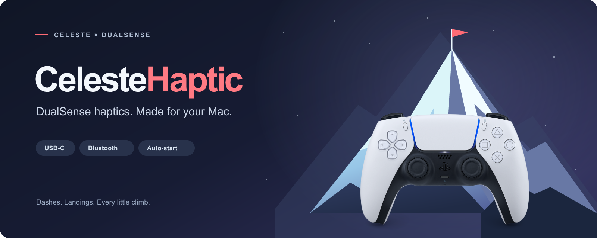

<p align="center">
  
</p>

<p align="center">
  <a href="https://github.com/faridbtw/CelesteHaptic/releases/latest/download/CelesteHaptic-macOS-v1.0.zip"></a>
</p>

<p align="center">Distinct DualSense effects for Celeste’s dashes, landings, climbing, and more.<br>Connect your controller, launch the game, and feel the difference.</p>

## Ready in three steps

1. **Download and unzip** the macOS release above.
2. **Quit Celeste**, then open `Install.command`.
3. **Connect your DualSense** and launch Celeste from Steam.

Keep vibration enabled in the game. Everything starts automatically with Celeste and closes when you quit.

Works with **vanilla Celeste on macOS**, on Apple Silicon and Intel. Tested with Steam version **1.4.0.0**. Everest is not supported.

## Choose your connection

| USB-C | Bluetooth |
| :--- | :--- |
| Plug the controller into your Mac. | Unplug USB, then connect **DualSense Wireless Controller** in macOS Bluetooth settings. |
| The companion selects the USB connection automatically. | Make sure it says **Connected**, then launch the game. |

No DSX, Wine, or extra controller driver is needed. If the companion loses its connection, the game falls back to ordinary vibration.

## What you’ll feel

| In the game | In your hands |
| :--- | :--- |
| **Dash** | A short, crisp sweep. |
| **Land or collide** | A quick, weighty thump. |
| **Climb or glide** | A lighter, continuous texture. |
| **Collect a refill** | A pair of pulses across the grips. |

The effects are made specifically for this mod from Celeste’s existing rumble events.

## Make it feel right

Celeste’s **Off / Half / On** vibration setting still applies. Haptics stop when you pause or switch away from the game.

For more control, quit Celeste and open `CelesteHaptic/settings.ini` in the game folder:

```ini
Enabled=true
MasterGain=1.4
```

| Gentler | Default | Strongest |
| :---: | :---: | :---: |
| `0.5` | `1.4` | `2.0` |

Save and restart the game. Set `Enabled=false` to use ordinary rumble instead.

## Easy to remove

Quit Celeste and open **`Uninstall.command`**. It restores the verified original game file and keeps your saves and settings.

<details>
<summary><strong>Controller tests and troubleshooting</strong></summary>

Quit the game and open **`Test Haptics.command`**. You should feel the left grip, then the right. For a wireless check, unplug USB, connect Bluetooth, and open **`Test Bluetooth Haptics.command`**.

If effects are silent:

- Check Celeste’s vibration setting and your controller’s connection in macOS.
- Try disabling Steam Input for Celeste.
- Close other controller utilities that might compete for the same connection.

The logs are in the game’s `CelesteHaptic` folder: `CelesteHaptic.log` and `HapticsBridge.log`.

USB output and Steam startup have been verified locally. The Bluetooth transport is shared with SilkHaptic and its encoder passes automated tests; live Bluetooth gameplay in Celeste still needs confirmation. Full results are in [VALIDATION.txt](VALIDATION.txt).

</details>

<details>
<summary><strong>Custom game folders and game updates</strong></summary>

For another Steam library, pass the Celeste game folder to the installer in Terminal:

```sh
"/path/to/CelesteHaptic/Install.command" "/path/to/steamapps/common/Celeste"
```

The installer backs up the original `Celeste.exe` in `CelesteHaptic/backups` and refuses to overwrite files changed by something else.

Steam’s **Verify integrity of game files** also restores the original game assembly. After a game update, verify the files first, keep your backups, remove the old `CelesteHaptic/install.json`, then run the installer again.

</details>

<details>
<summary><strong>Source and building</strong></summary>

The adapter intercepts 184 rumble call sites in the tested build and keeps the original rumble methods as a fallback. A stereo mixer generates 48 kHz waveforms and streams them to the native companion on localhost port 48113. Four motor-report guards keep ordinary SDL rumble from interrupting the replacement.

The native transport comes from [SilkHaptic](https://github.com/faridbtw/SilkHaptic). USB uses the DualSense actuator audio channels. Bluetooth uses direct HID waveform packets with a filtered 3 kHz stream. Celeste itself uses its bundled Intel runtime.

The adapter and effects are in [`src/Adapter`](src/Adapter), the transport is in [`src/Bridge`](src/Bridge), and the reversible Mono.Cecil installer is in [`src/Installer`](src/Installer).

To build, install Mono for `csc`, the .NET 8 SDK, and Xcode command-line tools, then run:

```sh
./build.sh
```

`CELESTE_GAME` selects a custom game folder; `DOTNET_EXE` selects a specific SDK executable. Run the checks with `python3 tests/run_tests.py`; add `--controller` for a hardware test with Celeste closed.

These are custom effects, not an official PS5 waveform library. No Celeste game files or assets are included in the download.

</details>

---

[MIT license](LICENSE) · [Third-party licenses](ThirdParty) · [Banner credits](assets/README.md)

<sub>Celeste belongs to its creators. DualSense is a Sony trademark. CelesteHaptic is an independent community mod.</sub>
